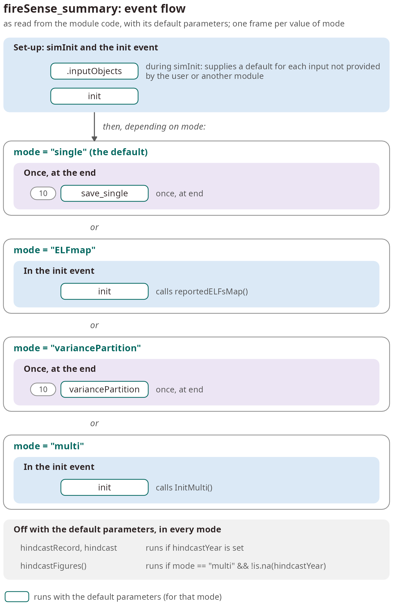
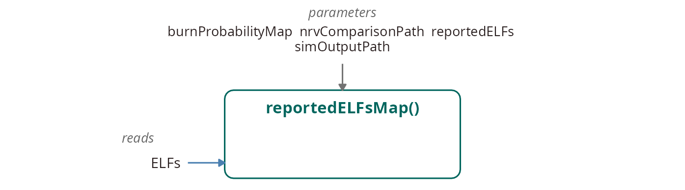
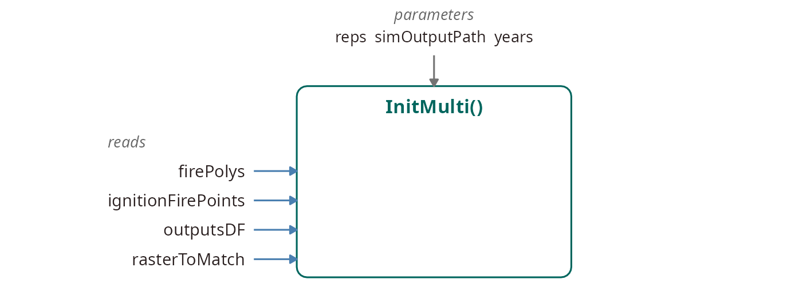
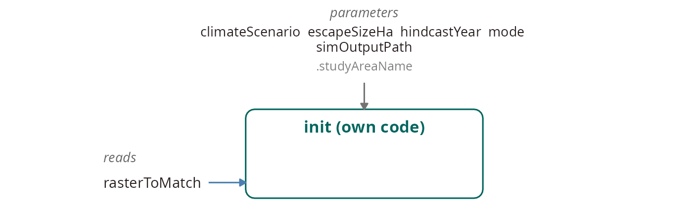
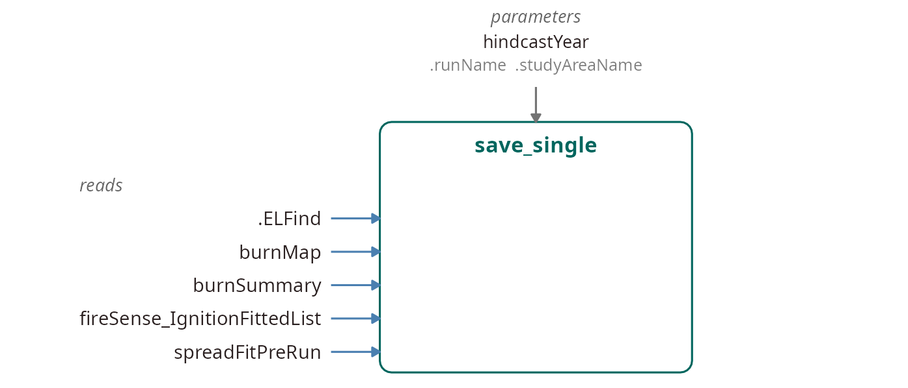
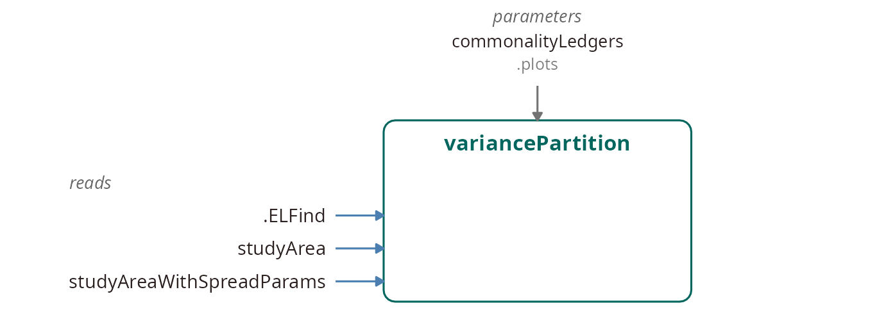

# Overview

Saves and summarizes `fireSense` burn results. It has these modes (parameter `mode`):

- `"single"` (default): run inside a simulation, after `fireSense_burn`. At `end(sim)` it writes `burnMap_year<end>.tif` and `fireSense_burnSummary.csv` to `outputPath(sim)`.
- `"multi"`: run on its own after several replicates have finished. It finds each replicate's burn map and burn summary and makes the simulated vs observed ignition, escape and area burned figures with `fireSenseUtils::plotHistoricFires()`; the burn map and the burn figures are `burnSummaries`'.
- `"variancePartition"`: run after `fireSense_dataPrepFit`, in a run of one ELF. At `end(sim)` it writes `variancePartition.csv` to `outputPath(sim)`: how much of the fire signal each part of the spread model carries (climate, fuel, young stands, non-forest), between years and within years. Method `"model"` splits the fitted model's linear predictor over the fit's own pixel-years (`fireSenseUtils::spreadVariancePartition()`); method `"commonality"`, with `commonalityLedgers`, compares four fits of the ELF with and without climate and fuel (`fireSenseUtils::commonalityPartition()`). One figure per ELF and method, through `Plots()`.

# Usage

Single mode needs no setup beyond adding the module to a simulation that includes `fireSense`.

Multi mode:


``` r
library(SpaDES.core)

mySim <- simInit(
  times = list(start = 2011, end = 2100),
  modules = list("fireSense_summary"),
  params = list(fireSense_summary = list(
    mode = "multi",
    simOutputPath = "outputs/myStudyArea", ## holds rep01/, rep02/, ...
    .studyAreaName = "myStudyArea",
    climateScenario = "CanESM5_SSP370",
    reps = 1L:10L
  )),
  objects = list(rasterToMatch = rasterToMatch),
  paths = list(modulePath = "..")
)
spades(mySim)
```

The replicate files are found either from `outputsDF` (the row-bound `outputs(sim)` of the replicates) or, without it, by searching `simOutputPath/rep*/`; in that case the module stops if a burn map or burn summary is missing.
Either way, a replicate's files are only those under its own folder (`rep1` is not `rep10`), and the module stops if a replicate in `reps` has no outputs.
Historical fires for the comparison figure come from `firePolys` and `ignitionFirePoints`, or are downloaded from the Canadian National Fire Database.

# Parameters


|paramName                |paramClass |default      |min |max |paramDesc                                                                                                                                                                                                                                                                                                                                                                                                                                                                                                                                                                                                                                                                                                                                                                          |cacheKey |
|:------------------------|:----------|:------------|:---|:---|:----------------------------------------------------------------------------------------------------------------------------------------------------------------------------------------------------------------------------------------------------------------------------------------------------------------------------------------------------------------------------------------------------------------------------------------------------------------------------------------------------------------------------------------------------------------------------------------------------------------------------------------------------------------------------------------------------------------------------------------------------------------------------------|:--------|
|.neverCache              |character  |init, sa.... |NA  |NA  |Events that are never cached, whatever `.useCache` says (read by SpaDES.core, 3.2.1.9037 or later): every event reads the run's output files or writes files (maps, csv, figures), none of which is in the event's cache key, and a cache hit would write nothing.                                                                                                                                                                                                                                                                                                                                                                                                                                                                                                                 |TRUE     |
|climateScenario          |character  |NA           |NA  |NA  |Name of the CMIP6 climate scenario including SSP, formatted as in `ClimateNA`, e.g. 'CanESM5_SSP370'. Used in figure filenames (multi mode).                                                                                                                                                                                                                                                                                                                                                                                                                                                                                                                                                                                                                                       |TRUE     |
|mode                     |character  |single       |NA  |NA  |'single': run within a simulation, saving `burnMap` and `burnSummary` at `end(sim)`. 'multi': summarize the saved outputs of several replicates in figures. 'ELFmap': draw only the map of Canada's ELFs with `reportedELFs` filled, from `ELFs` (e.g. the ELFs a multi-ELF report covers): green, or, with `nrvComparisonPath`, coloured by the percentage of the ELF's NRV tests inside the natural range; written to `simOutputPath` as ELFmap. 'variancePartition': at `end(sim)`, how much of the fire signal each part of the spread model carries (climate, fuel, young stands, non-forest), between years and within years, for the ELF of the run (`variancePartitionSave()`); written to `variancePartition.csv` in `outputPath(sim)`, with a figure per ELF and method. |TRUE     |
|nrvComparisonPath        |character  |NA           |NA  |NA  |(mode = 'ELFmap') folder with one subfolder per reported ELF, each holding below it NRV_summary's `nrvInside.csv`. The ELFs are coloured by the percentage of their tests inside the NRV (red none, green all): `ELFmap` over all tests, `ELFmap_stand` over the stand-level tests only, and `ELFmap_st_<metric>` for each stand-level metric (below, inside or above the NRV range). The table is written to `simOutputPath` as `ELFmap_insideNRV.csv`. `NA`: the ELFs are filled green.                                                                                                                                                                                                                                                                                          |TRUE     |
|burnProbabilityMap       |logical    |TRUE         |NA  |NA  |(mode = 'ELFmap') also write the national maps of annual burn probability to `simOutputPath`: `NRVburnProbability.tif` (simulated) and `NRVburnProbabilityHistoric.tif` (observed), cloud-optimized GeoTIFFs in EPSG:3978, from each reported ELF's `meanAnnualCumulBurnMap.tif` and `meanAnnualCumulBurnMapHistoric.tif` (burnSummaries) found below `simOutputPath/<ELF>/`, blended across the ELFs' overlaps (`fireSenseUtils::mosaicELFs()`). `FALSE`: only the ELF map.                                                                                                                                                                                                                                                                                                       |TRUE     |
|reportedELFs             |character  |NA           |NA  |NA  |(mode = 'ELFmap') the ELFs filled (and labelled) on the map, e.g. c("6.4", "9.3").                                                                                                                                                                                                                                                                                                                                                                                                                                                                                                                                                                                                                                                                                                 |TRUE     |
|commonalityLedgers       |character  |NA           |NA  |NA  |(mode = 'variancePartition') the spread ledger files of four fits of the ELF, named `none`, `climate`, `fuel` and `climateFuel` (no covariate, climate only, fuel only, both), e.g. the files of FireSenseTesting's trials; read from `commonalityLedgerFolder`, the rows within `studyArea`. `NA` (default): no commonality partition, only the model-based one.                                                                                                                                                                                                                                                                                                                                                                                                                  |TRUE     |
|commonalityHindcastPaths |character  |NA           |NA  |NA  |(mode = 'variancePartition') the hindcast output folders of the fits of `commonalityLedgers`, named as they are; each holds `<ELF>/<year>/<set>/` with `hindcast_reps.csv` and `hindcast_observed.csv`. When all four fits of an ELF have hindcasts, the commonality between-year score uses their annual areas, else the fits' in-sample ones (column `annualSource`). `NA` (default): the in-sample ones.                                                                                                                                                                                                                                                                                                                                                                        |TRUE     |
|commonalityLedgerFolder  |character  |https://.... |NA  |NA  |(mode = 'variancePartition') the Google Drive folder of `commonalityLedgers`.                                                                                                                                                                                                                                                                                                                                                                                                                                                                                                                                                                                                                                                                                                      |TRUE     |
|simOutputPath            |character  |/tmp/Rtm.... |NA  |NA  |Directory holding the replicate output directories, and where figures are written (multi mode). Not part of the event cache key: in multi mode, which reads the replicate folders under it, keep `.useCache` off, or a changed folder would give a stale cache hit.                                                                                                                                                                                                                                                                                                                                                                                                                                                                                                                |FALSE    |
|.plots                   |character  |screen       |NA  |NA  |Passed to `types` in `Plots()`, e.g. "screen" (default), "png": the hindcast figures (multi mode) and the ELF map (mode = 'ELFmap'). `NA` or `NULL`: no plots.                                                                                                                                                                                                                                                                                                                                                                                                                                                                                                                                                                                                                     |TRUE     |
|.runName                 |character  |NA           |NA  |NA  |Name of this run, e.g. '13.1_NRV_370_1'; names its metrics file (`fireSenseUtils::ELFmetricsFilename()`). `NA`: the name of `outputPath(sim)`.                                                                                                                                                                                                                                                                                                                                                                                                                                                                                                                                                                                                                                     |TRUE     |
|.studyAreaName           |character  |NA           |NA  |NA  |Human-readable name for the study area; used in figure paths and filenames (multi mode). If `NA`, a hash of `rasterToMatch` will be used.                                                                                                                                                                                                                                                                                                                                                                                                                                                                                                                                                                                                                                          |TRUE     |
|reps                     |integer    |1, 2, 3,.... |1   |NA  |Replicate numbers to summarize (multi mode). Files are read with `mclapply`; set `options(mc.cores = )` to run in parallel.                                                                                                                                                                                                                                                                                                                                                                                                                                                                                                                                                                                                                                                        |TRUE     |
|escapeSizeHa             |numeric    |50           |0   |NA  |Size (ha) of the whole fire polygon at which a fire counts as an escape in the hindcast (`nFires50` columns); as in the fit, so it is checked against the other modules' `escapeSizeHa` (`paramCheckOtherMods`, error).                                                                                                                                                                                                                                                                                                                                                                                                                                                                                                                                                            |TRUE     |
|fireCauses               |character  |natural,.... |NA  |NA  |The fire causes the hindcast counts (observed natural-cause fires, ignitions and escapes); as in the fit, so it is checked against the other modules' `fireCauses` (`paramCheckOtherMods`, error).                                                                                                                                                                                                                                                                                                                                                                                                                                                                                                                                                                                 |TRUE     |
|hindcastInterval         |numeric    |1            |0   |NA  |Hindcast: time between the simulated rep-years. A job for year Y runs times Y, Y + interval, ...; rep = round((time - hindcastYear) / interval) + 1. Set it to the predict modules' interval (e.g. 0.001).                                                                                                                                                                                                                                                                                                                                                                                                                                                                                                                                                                         |TRUE     |
|hindcastYear             |integer    |NA           |NA  |NA  |Hindcast validation: the observed year the simulated rep-years are compared with. `NA` (default): no hindcast. Single mode records each rep-year and, at `end(sim)`, writes `hindcast_reps.csv`, `hindcast_sizes.csv`, `hindcast_observed.csv`, `hindcast_observedSizes.csv`, `hindcast_observedPolys.gpkg`, `hindcast_observedPoints.gpkg`, `hindcast_burnMap.tif` and, per rep when `repMaps` is TRUE, `hindcast_burnID_rep<rep>.tif`, `hindcast_ignitionProb_rep<rep>.tif` and `hindcast_escapeProb_rep<rep>.tif`. Multi mode pools the replicate folders (parameter sets) in hindcast figures instead of the usual multi-mode figures.                                                                                                                                         |TRUE     |
|repMaps                  |logical    |TRUE         |NA  |NA  |Hindcast (single mode): write the per-rep maps (`hindcast_burnID_rep<rep>.tif`, `hindcast_ignitionProb_rep<rep>.tif`, `hindcast_escapeProb_rep<rep>.tif`). `FALSE` skips them and does not need `fireSense_IgAndEscapeProbRas` (a replay job has no ignition module); all tables and observed files are unchanged.                                                                                                                                                                                                                                                                                                                                                                                                                                                                 |TRUE     |
|years                    |integer    |NA, NA       |NA  |NA  |Which two simulation years should be compared? Typically start and end years. Defaults to the simulation's own start and end times.                                                                                                                                                                                                                                                                                                                                                                                                                                                                                                                                                                                                                                                |TRUE     |

# Events

- `init`: in single mode, schedules `save_single` at `end(sim)`. In multi mode, does all the work: locates the files and makes the figures.
- `save_single`: writes the burn map and burn summary (single mode only).
- `variancePartition`: writes `variancePartition.csv` and its figures (mode `"variancePartition"` only).


<div class="figure">

<p class="caption">fireSense_summary events, as read from the module code with its default parameters.</p>
</div>

The table below lists, for each object, the code that writes it and the code that only reads it.

<table class="table" style="width: auto !important; border-bottom: 0;">
<caption>Where each object of fireSense_summary is written and read, in run order.</caption>
 <thead>
  <tr>
   <th style="text-align:left;"> Object </th>
   <th style="text-align:left;"> Written by </th>
   <th style="text-align:left;"> Read by </th>
  </tr>
 </thead>
<tbody>
  <tr grouplength="12"><td colspan="3" style="border-bottom: 1px solid;"><strong>Inputs</strong></td></tr>
<tr>
   <td style="text-align:left;padding-left: 2em;" indentlevel="1"> ELFs </td>
   <td style="text-align:left;">  </td>
   <td style="text-align:left;"> init: reportedELFsMap() (ELFmap) </td>
  </tr>
  <tr>
   <td style="text-align:left;padding-left: 2em;" indentlevel="1"> firePolys </td>
   <td style="text-align:left;">  </td>
   <td style="text-align:left;"> init: InitMulti() (multi) </td>
  </tr>
  <tr>
   <td style="text-align:left;padding-left: 2em;" indentlevel="1"> ignitionFirePoints </td>
   <td style="text-align:left;">  </td>
   <td style="text-align:left;"> init: InitMulti() (multi) </td>
  </tr>
  <tr>
   <td style="text-align:left;padding-left: 2em;" indentlevel="1"> outputsDF </td>
   <td style="text-align:left;">  </td>
   <td style="text-align:left;"> init: InitMulti() (multi) </td>
  </tr>
  <tr>
   <td style="text-align:left;padding-left: 2em;" indentlevel="1"> rasterToMatch </td>
   <td style="text-align:left;">  </td>
   <td style="text-align:left;"> init: InitMulti() (multi), init (own code) </td>
  </tr>
  <tr>
   <td style="text-align:left;padding-left: 2em;" indentlevel="1"> .ELFind </td>
   <td style="text-align:left;">  </td>
   <td style="text-align:left;"> save_single (single), variancePartition (variancePartition) </td>
  </tr>
  <tr>
   <td style="text-align:left;padding-left: 2em;" indentlevel="1"> burnMap </td>
   <td style="text-align:left;">  </td>
   <td style="text-align:left;"> save_single (single) </td>
  </tr>
  <tr>
   <td style="text-align:left;padding-left: 2em;" indentlevel="1"> burnSummary </td>
   <td style="text-align:left;">  </td>
   <td style="text-align:left;"> save_single (single) </td>
  </tr>
  <tr>
   <td style="text-align:left;padding-left: 2em;" indentlevel="1"> fireSense_IgnitionFittedList </td>
   <td style="text-align:left;">  </td>
   <td style="text-align:left;"> save_single (single) </td>
  </tr>
  <tr>
   <td style="text-align:left;padding-left: 2em;" indentlevel="1"> spreadFitPreRun </td>
   <td style="text-align:left;">  </td>
   <td style="text-align:left;"> save_single (single) </td>
  </tr>
  <tr>
   <td style="text-align:left;padding-left: 2em;" indentlevel="1"> studyArea </td>
   <td style="text-align:left;">  </td>
   <td style="text-align:left;"> variancePartition (variancePartition) </td>
  </tr>
  <tr>
   <td style="text-align:left;padding-left: 2em;" indentlevel="1"> studyAreaWithSpreadParams </td>
   <td style="text-align:left;">  </td>
   <td style="text-align:left;"> variancePartition (variancePartition) </td>
  </tr>
</tbody>
<tfoot><tr><td style="padding: 0; " colspan="100%">
<sup></sup> Not shown, off with the default parameters: hindcastFigures(), hindcastRecord, hindcast. Not shown, touching no object in the metadata: .inputObjects. Not traced to any code (e.g. reached indirectly): ignitionsAndEscapes, fireSense_IgAndEscapeProbRas, rasterToMatchELF, flammableRTM, rstAnnualBurnID, fireSense_SpreadParamSet, fireSense_annualSpreadFitCovariates, fireSense_nonAnnualSpreadFitCovariates.</td></tr></tfoot>
</table>


## reportedELFsMap() {-}

mode = "ELFmap": called by the init event

{width=100%}


## InitMulti() {-}

mode = "multi": called by the init event

{width=100%}


## init (own code) {-}

the init event's own code, outside the functions it calls

{width=100%}


## save\_single {-}

mode = "single": once, at end

{width=100%}


## variancePartition {-}

mode = "variancePartition": once, at end

{width=100%}

## Plotting

Multi mode only. Figures are `.png` files under `simOutputPath`, registered in `outputs(sim)`: burn summaries across replicates, cumulative burns, and simulated versus historical ignitions, escapes and area burned.

## Saving

Single mode only; see `save_single`.

# Data dependencies

## Input data


|objectName                             |objectClass |desc                                                                                                                                                                                                                                                       |sourceURL |
|:--------------------------------------|:-----------|:----------------------------------------------------------------------------------------------------------------------------------------------------------------------------------------------------------------------------------------------------------|:---------|
|burnMap                                |SpatRaster  |Cumulative burn map from `fireSense_burn`. Required in single mode.                                                                                                                                                                                        |NA        |
|burnSummary                            |data.table  |Fire summary table from `fireSense_burn`. Required in single mode.                                                                                                                                                                                         |NA        |
|firePolys                              |list        |Optional; multi mode. List of annual historical fire polygons. If missing, the NFDB polygons are downloaded.                                                                                                                                               |NA        |
|ignitionFirePoints                     |SpatVector  |Optional; multi mode. Historical fire ignition points. If missing, the NFDB points are downloaded.                                                                                                                                                         |NA        |
|ignitionsAndEscapes                    |data.table  |Optional; hindcast (single mode). This year's ignitions (`pixelID`, `escaped`) from `fireSense_ignitionPredict`.                                                                                                                                           |NA        |
|fireSense_IgAndEscapeProbRas           |SpatRaster  |Optional; hindcast (single mode). This year's layers `ignitionProb` and `escapeProb` from `fireSense_ignitionPredict`, written for every rep.                                                                                                              |NA        |
|rasterToMatchELF                       |SpatRaster  |Optional; hindcast (single mode). The ELF core. Only fires that start in it are counted, each at its whole extent, core and buffer.                                                                                                                        |NA        |
|flammableRTM                           |SpatRaster  |Optional; hindcast (single mode). The burnable pixels of the core and the buffer (from `fireSense_burn`): the area an observed fire polygon could have burned in the simulation.                                                                           |NA        |
|rstAnnualBurnID                        |SpatRaster  |Optional; hindcast (single mode). This year's fire IDs from `fireSense_burn`.                                                                                                                                                                              |NA        |
|fireSense_SpreadParamSet               |integer     |Optional; hindcast (single mode). The row of the fitted parameter sets this year's spread prediction used, from `fireSense_spreadPredict`; written as the `paramSet` column of the hindcast tables (`NA` if absent or, with several ELFs, not one number). |NA        |
|outputsDF                              |data.table  |Optional; multi mode. `outputs(sim)` of all replicates, row-bound. Its `file` column locates the burn maps and summaries. If missing, `simOutputPath` is searched.                                                                                         |NA        |
|spreadFitPreRun                        |data.frame  |Optional; from `fireSense_ELFs`. Its attribute `spreadFitFiles` names the ledger file of each ELF's spread fit, recorded in the run's metrics row.                                                                                                         |NA        |
|fireSense_IgnitionFittedList           |list        |Optional; from `fireSense_ELFs`. Its attribute `ignitionFitFiles` names the ledger file of each ELF's ignition fit, recorded in the run's metrics row.                                                                                                     |NA        |
|.ELFind                                |character   |Optional; single mode. The ELF of this run, recorded in its metrics row. Mode 'variancePartition': the ELFs (ledger rows) partitioned; `NULL`: every row.                                                                                                  |NA        |
|studyAreaWithSpreadParams              |data.frame  |Required in mode 'variancePartition'. The spread ledger rows of the study area, from `fireSense_dataPrepFit`.                                                                                                                                              |NA        |
|fireSense_annualSpreadFitCovariates    |list        |Required in mode 'variancePartition'. The annual (climate) covariates of the spread fit, one table per year, from `fireSense_dataPrepFit`.                                                                                                                 |NA        |
|fireSense_nonAnnualSpreadFitCovariates |list        |Required in mode 'variancePartition'. The non-annual (fuel) covariates of the spread fit, one table per data year, from `fireSense_dataPrepFit`.                                                                                                           |NA        |
|studyArea                              |sf          |Mode 'variancePartition' with `commonalityLedgers`: the study area, whose rows of the four ledgers are read (an `sf` or a `SpatVector`).                                                                                                                   |NA        |
|ELFs                                   |list        |Required in mode 'ELFmap'. All ELFs as fireSense_ELFs leaves them (merges applied): a list with `rasWhole`, `rasCentered` and, if present, `poly`.                                                                                                         |NA        |
|rasterToMatch                          |SpatRaster  |Template raster of the simulations. Required in multi mode.                                                                                                                                                                                                |NA        |

## Output data

None; results are files on disk.


|objectName |objectClass |desc |
|:----------|:-----------|:----|
|NA         |NA          |NA   |

# Links to other modules

Uses `burnMap` and `burnSummary` from `fireSense_burn`.
